  

I build web apps, macOS tools, games and embedded projects, and contribute Japanese localization to software and education tools.

## Tech stack

  <b>Web</b> 
  
  
  
  
  
  
  
  
   React Three Fiber

 

  <b>Data and runtime</b> 
  
  
  
   IndexedDB

 

  <b>Apps and games</b> 
  
  
  
  
  
   SwiftUI · Rapier

 

  <b>Embedded</b> 
  
  
  
   Raspberry Pi Pico W · I²C

 

  <b>Infrastructure and tools</b> 
  
  
  
  
  
  
  
  
  
  
  
  
  
  
   GitHub Pages

## Localization

- Japanese translation and proofreading — Micro:bit Educational Foundation
- Japanese translation and proofreading — Microsoft MakeCode
- Japanese translator — Hypixel Network
- Japanese translator — Proton VPN

## Elsewhere

- Official ambassador (3rd cohort) — Minna no Ginko
- Guest on episode 65 of HBC Radio's *Dosanko Tech High School — Mirai Navi*, October 22, 2026 ([program page](https://www.hbc.co.jp/radio/dosanko-tech/))
- Featured in the Yomiuri Shimbun in a school public-relations article
- Appeared in an award-winning Japanese theatrical film

## Certifications

- Google AI Professional Certificate
- Generative AI Leader Professional
- Google AI Essentials
- Google Prompting Essentials

## GitHub

Public repositories, stars and followers.

  

  

